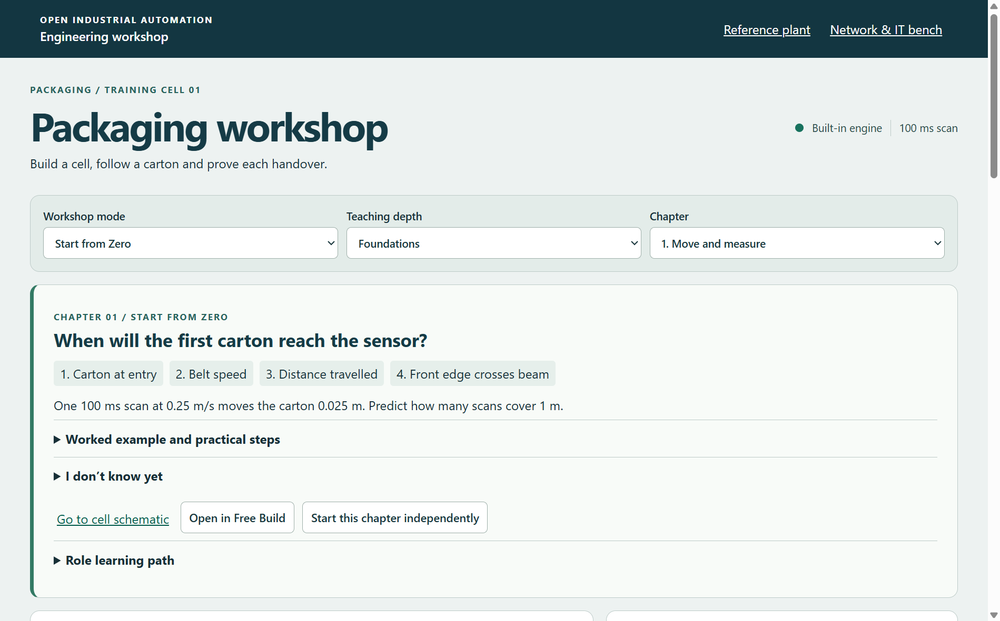

# Windows 0.2.0 first-run observation

The installed 0.2.0 program was inspected read-only. A copy of app.asar had SHA-256 5AB5F536B2E05C59FFCB9D7DDB0AB034B2DBBE52A767DB788C9E47A38D914CBA. It contained main.cjs, preload.cjs, native.cjs, engine.cjs, occt.cjs and the package manifest. The manifest reported version 0.2.0. main.cjs selected workshop://local/workshop/index.html and checked the mode selector and asset-placement button before showing the window.

A separate process launched the installed executable with a new, empty user-data directory and the hidden test-window switch. The native renderer capture shows the first frame after the page initialised at 1266 × 787 CSS pixels. Its title was Packaging workshop. The mode was Start from Zero, the teaching depth was Foundations and the chapter was 1. Move and measure. Only the Open in Free Build and Start this chapter independently buttons fell entirely inside the initial viewport. The machine schematic was below the fold.

The test process closed its own window. The existing user's profile, projects and installation were not modified.
