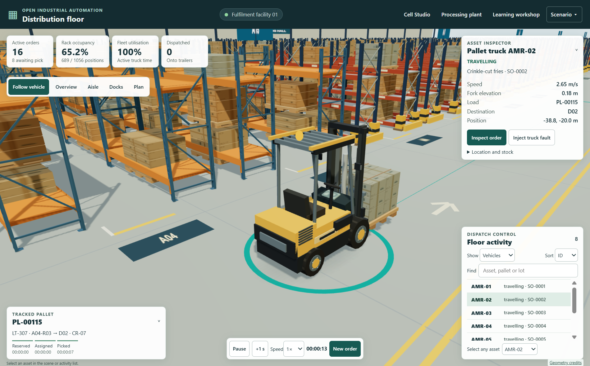
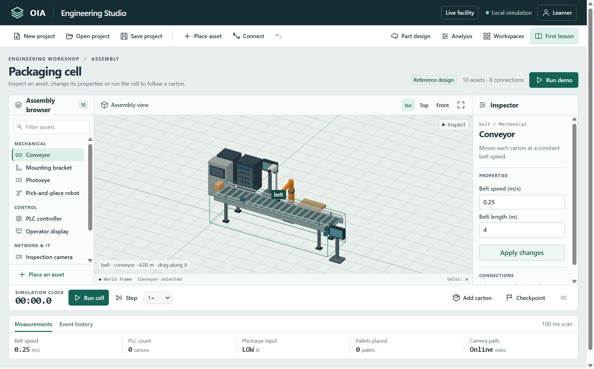

# Windows 0.3.0 package acceptance

The Windows x64 NSIS installer OIA-Workshop-0.3.0-Windows-x64.exe is 124526005 bytes. SHA-256 E0D428D0391002FC16A4B3B645F3618241230A62B82F3DB449E395ACC8021D76. Get-AuthenticodeSignature returned NotSigned.

## Package identity

Packaging ran on Windows 11 x64 using Electron 45.2.2 and electron-builder 26.18.0. The packaged ASAR SHA-256 is da669b407a4d8bf0075b0eb5d41eefc970f6daeca6cfa1559690f9384bef7250. All five host modules and five native resources matched the corresponding release source bytes. All 194 shared browser files matched the frozen web build. The ordered file/path digest is 132233531e839963c9c6148c0a7c0e1cae15e8fa57a28f6b2a184f89426c407c.

| Check | Observed result |
|---|---|
| First run | The packaged executable opened the distribution floor in a fresh QA profile. The 1266 × 725 CSS-pixel viewport showed the loaded pallet truck moving among warehouse racks. Inventory exposed 388 selections. |
| Offline facility | Chromium offline emulation followed by a reload kept the floor operational. Native export wrote oia-facility v1 JSON. Import with a different seed and a fresh export proved the restored seed. |
| Cell Studio | Cell Studio opened from the facility. WebGL rendered an 807 × 337 CSS-pixel assembly viewport. Saving the reference, creating an empty project and reopening the saved reference restored the original assembly. |
| Portable projects | Studio output opened in Classic. Windows Classic exported a custom conveyor. Edge reopened it, edited the notebook and exported it. Studio reopened the Edge file and wrote the same notebook entry and conveyor journal back to disk. |
| Native STEP | The real Windows Open dialog selected photoeye-assembly.step. FreeCAD measured its width as 0.100 m. |
| Shared engineering benches | Offline Open CASCADE measured 0.1000 × 0.0400 × 0.0500 m. SQLite returned 143 for SELECT 13 * 11. |
| Readiness | Holding the Classic and commissioning modules kept their entire bodies inert. Both pages became active after module release. No renderer page errors were recorded across the packaged smoke run. |
| Recovery | In development-process checks, the facility retained a selected truck fault, the studio retained a blank assembly and Classic retained a saved notebook after both forced renderer crashes and isolated main-process termination. Boot tests with blank entry pages fell back through facility, cell and classic, then showed an unprivileged recovery page when all three were blank. |
| Native tests | Seven tests passed with no skips, including real STEP conversion and writer-process failure on both sides of atomic file replacement. |

The packaged smoke test used a separate user-data directory, a hidden native window and no external services. ANGLE selected Intel UHD Graphics with Direct3D 11 at device pixel ratio 1.5. The hidden-window animation callback interval averaged 1003.9 ms over 90 intervals, with 1004.2 ms at the 95th percentile. This observation cannot establish foreground rendering throughput or RTX performance. The system NVIDIA inventory separately reported an RTX 4060 Laptop GPU with 8188 MiB. Isaac Sim was absent from the standard runtime location.

## Reproduction

From windows, run npm test with OIA_FREECAD_TEST=1. Run node verify-package.cjs with the packaged executable and frozen dist directory as arguments. Run node verify.cjs with that executable to exercise offline functionality, native file operations and cross-platform project compatibility. Supply a fresh OIA_TEST_DIRECTORY for a first-run observation. The developer recovery suites are npm run test:crash and npm run test:fallback. They work in isolated profiles and copies.

These are package and isolated recovery observations. Per-user upgrade, Start menu launch, clean-VM installation and public release verification are separate acceptance checks.
