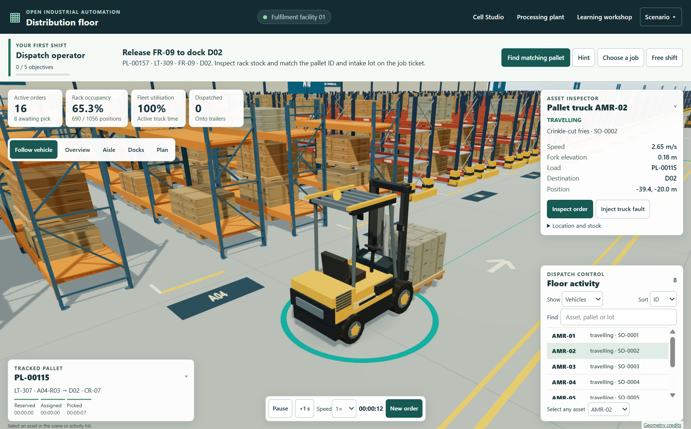
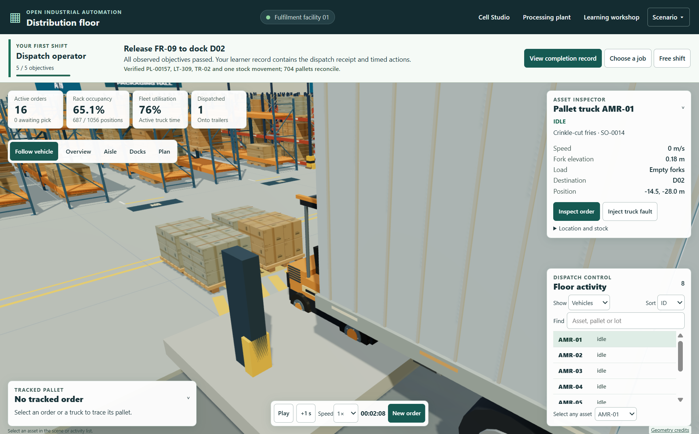

# Windows 0.3.1 practical acceptance

OIA-Workshop-0.3.1-Windows-x64.exe is a per-user NSIS x64 installer, 124552654 bytes. SHA-256 E89316EFFF00470F2732354EE26B2CFA3058A87C858A69F1C53C4C8E36A5569E. Get-AuthenticodeSignature returned NotSigned.

All 200 browser files in the packaged application matched the frozen distribution. Ordered tree digest 5a04c65c5a0bcf51e3150d75469a3534c275588c2e8d15c80b6c1b0a09542048. ASAR digest 1f11f8b32441bc9d907e1239e37de9e91ae1f64ccb75628e448f100b40fe5e4e. Five native resources and five host modules matched their source bytes.

## Packaged learner checks

A fresh Windows profile launched the packaged executable at the ordinary distribution floor entry. Chromium offline emulation was enabled and the page reloaded. The job ticket, 0/5 objectives and Find matching pallet control appeared inside the first viewport. All edits and assessments used the visible application controls.

| Practical | Measured result |
|---|---|
| Dispatch operator | Matched PL-00157, FR-09 and LT-309. Selecting D01 was rejected and progress stayed at 1/5. The correct D02 reservation, assignment to AMR-02, pallet dispatch and trailer TR-02 receipt completed all five objectives. All five remained complete after reload. |
| PLC wiring | The incorrect terminal produced zero counts for two fresh cartons. The corrected input counted exactly once on each carton despite five consecutive high scans. On the transfer case, changing to the other measured input also counted both cartons exactly once. |
| Drive commissioning | The weak controller failed. For the first load, a 6 N prediction and gains 32/28 gave 0.60 s rise, 2.00 s recovery and 1.0% overshoot. For the changed load, a 7 N prediction and gains 55/30 gave 0.66 s rise, 2.62 s recovery and 0.0% overshoot. Both designs passed all four criteria. |
| Bracket drawing | The starter geometry failed. A prior volume prediction of 20.736 cm³, corrected 100 × 50 mm profile with 6 mm walls and 24 mm extrusion passed all seven checks. The app mounted the accepted part in the active cell. |
| Existing profile | In an isolated profile the actual installed 0.3.0 program recorded an AMR-01 truck fault. The packaged 0.3.1 program opened that profile with the first job visible. The first objective completed, and leaving the job restored the pre-existing faulted free shift. |

No renderer page errors were recorded in the full graded run. The test was automated on Windows 11 x64. Human learning transfer and real plant performance remain unchecked.

## Reproduce

From windows, run node verify-jobs.cjs with the 0.3.1 application executable path. To replay the learner-profile migration in isolation, run node verify-job-upgrade.cjs with the 0.3.0 application executable followed by the 0.3.1 executable. The checks create fresh QA profiles and never open the default user profile. Installer publication, the actual user-account upgrade and clean-VM lifecycle are separate checks.
